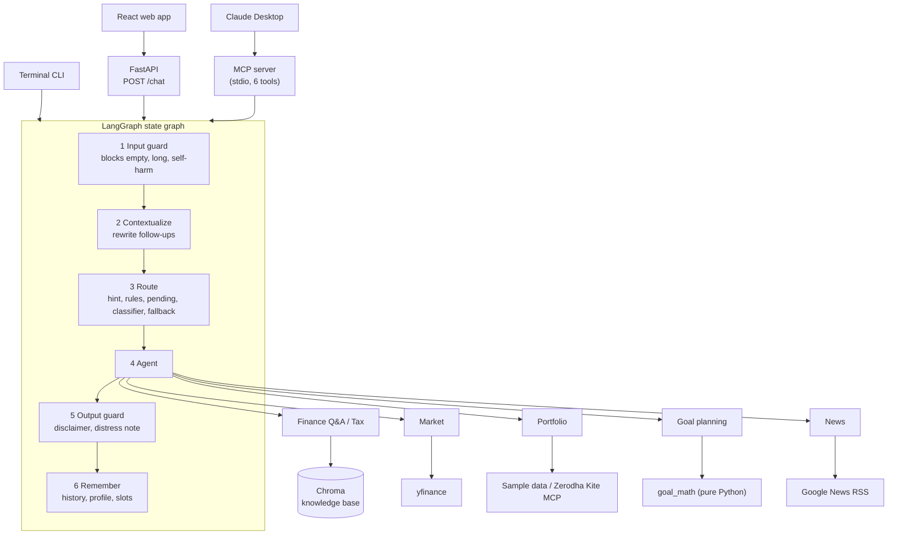

# Finnie: AI Finance Assistant

A multi-agent personal-finance **education** assistant for Indian investors, built with **LangGraph**, **LangChain**, **FastAPI**, **React** and **MCP**. It explains concepts and taxes with cited sources, quotes live prices, analyses a portfolio, projects savings goals and summarises the news. It is read-only and never gives financial advice.

> Capstone for *Applied Agentic AI for SWEs*. The problem statement and grading rubric are in the parent folder's [`../README.md`](../README.md).

**Author and owner:** Santhosh D S, santhoshdasari786@gmail.com
**License:** [PolyForm Noncommercial 1.0.0](LICENSE): free for personal, educational and other non-commercial use; **no commercial use**. See [License](#license).

---

## Contents

1. [What it does](#what-it-does)
2. [Status](#status)
3. [Architecture](#architecture)
4. [The six agents](#the-six-agents)
5. [Quick start](#quick-start)
6. [Four ways to use it](#four-ways-to-use-it)
7. [Usage examples](#usage-examples)
8. [HTTP API](#http-api)
9. [Configuration](#configuration)
10. [Tests](#tests)
11. [Docker](#docker)
12. [Project structure](#project-structure)
13. [Design decisions](#design-decisions)
14. [Troubleshooting](#troubleshooting)
15. [Known limits](#known-limits)
16. [More documentation](#more-documentation)
17. [License](#license)

---

## What it does

| You say | Finnie does |
|---|---|
| "What is an expense ratio?" | answers from the knowledge base, with numbered citations |
| "How are mutual fund gains taxed?" | explains the concept (not your tax), flags that rules change |
| "What is TCS trading at? And the Nifty?" | live quotes with the time and the data source |
| "Analyze my portfolio" | allocation, diversification and a risk bucket, from a sample portfolio or your Zerodha account (read-only) |
| "Can I reach 1 crore in 10 years?" | three illustrative scenarios, and the monthly amount you would need |
| "What is happening with RBI rates?" | a short cited story built from clustered headlines |

**The design rule behind it: the LLM never calculates and never advises.** Numbers come from code. The LLM extracts, classifies or narrates, and every failure falls back to something safe. Every answer carries a disclaimer.

## Status

All six agents, the knowledge base, the guardrails, memory, the HTTP API, the React app and the MCP server are built and tested.

| Piece | Status |
|---|---|
| Finance Q&A, Tax Education, Market Analysis, Portfolio Analysis, Goal Planning, News Synthesizer | Done |
| RAG knowledge base (Chroma, Gemini embeddings, glossary, citations) | Done (15 articles; growing, see [backlog](docs/knowledge-base/content-backlog.md)) |
| LangGraph workflow: guards, follow-up rewriting, router, memory | Done |
| HTTP API (`/chat`, `/agents`, `/sessions`, `/health`) | Done |
| React web app | Done (Chat, Portfolio, Market and Goals tabs; hand-written SVG charts) |
| MCP server for Claude Desktop (six read-only tools) | Done, verified over stdio |
| Docker image (API) | Done |
| Automated tests | **1,812 Python tests** at **86% line coverage**, plus **477 web-app tests** |
| Market data cache, retry with backoff and stale fallback | Done (30 min TTL, configurable) |

## Architecture



- **One contract for every agent:** `run(query, ctx) -> AgentResult` with a status (`ok`, `no_source`, `clarify`, `redirect`, `needs_login`, `error`), text, citations, data, meta and a mandatory disclaimer. Any interface (API, CLI, MCP) is a thin adapter over the same graph.
- **Router tiers:** an explicit hint, then keyword rules, then an agent that is waiting for an answer, then a gated LLM classifier (strict JSON, confidence floor, timeout), then a safe fallback to concept Q&A.
- **Memory:** per-conversation history, a saved profile (for example risk level), per-agent slots (a goal's numbers), and a pending question when an agent needs more information.
- **Grounding:** every number in an LLM narration must appear in the facts the code computed, or the narration is dropped.

Full design: [`docs/PROJECT_RECAP.md`](docs/PROJECT_RECAP.md) (end-to-end recap) and [`docs/TECHNICAL_DESIGN.md`](docs/TECHNICAL_DESIGN.md).

## The six agents

| Agent | What it does | Doc |
|---|---|---|
| **Finance Q&A** | glossary hit or retrieval, then an answer written only from numbered sources; no valid citation means "no source" | [doc](docs/agents/finance_qa_agent.md) |
| **Tax Education** | Q&A restricted to the tax topic, concepts not numbers, stronger disclaimer | [doc](docs/agents/tax_education_agent.md) |
| **Market Analysis** | yfinance quotes behind a provider registry, with `as_of` and `source`; understands Nifty 50 and Sensex by name | [doc](docs/agents/market_analysis_agent.md) |
| **Portfolio Analysis** | sample portfolio or live Zerodha through Kite MCP (read-only by `(tool, mode)` allowlist); metrics in pure Python | [doc](docs/agents/portfolio_agent.md) |
| **Goal Planning** | the LLM turns words into numbers; `goal_math` projects, solves for the monthly amount, or the years needed | [doc](docs/agents/goal_planning_agent.md) |
| **News Synthesizer** | Google News RSS, noise and relevance filters, near-duplicate clustering, a vetted cited story | [doc](docs/agents/news_synthesizer_agent.md) |

## Quick start

**Prerequisites:** Python 3.11+ (developed on 3.12), [`uv`](https://docs.astral.sh/uv/), Node 20+ (only for the web app), and a Google AI Studio API key (the default provider; OpenAI and Anthropic also work, see [Configuration](#configuration)). A Zerodha account is optional: the sample portfolio needs no login.

```bash
cd ai_finance_assistant
uv sync                       # creates .venv from pyproject.toml and uv.lock
cp .env.example .env          # then put your GOOGLE_API_KEY in .env
```

Without `uv`: `python -m venv .venv && .venv/bin/pip install -r requirements.txt`.

**Build the knowledge base index once** (it embeds the articles with Gemini and writes `./.vectorstore/`):

```bash
.venv/bin/python -m src.rag.ingestion.cli --config src/config/rag.yaml
```

Check retrieval from the terminal:

```bash
.venv/bin/python -m src.rag.retrieval.cli "what is rupee cost averaging?" --config src/config/rag.yaml
```

## Four ways to use it

### 1. Terminal CLI

```bash
.venv/bin/python -m src.agents.cli
```

Ask anything. `/agent tax_education What is 80C?` forces an agent; a blank line quits.

### 2. HTTP API

```bash
.venv/bin/python -m uvicorn src.main:app --port 8000
open http://localhost:8000/docs        # generated OpenAPI page
```

### 3. Web app

```bash
cd src/web_app
npm install
npm run dev                            # http://localhost:5173, expects the API on :8000
```

Notes: [`docs/WEB_APP.md`](docs/WEB_APP.md).

### 4. Claude Desktop (MCP)

Add this to `~/Library/Application Support/Claude/claude_desktop_config.json` (use absolute paths), then restart Claude Desktop:

```json
{
  "mcpServers": {
    "finnie": {
      "command": "/ABSOLUTE/PATH/ai_finance_assistant/.venv/bin/python",
      "args": ["-m", "src.mcp_server"],
      "env": { "PYTHONPATH": "/ABSOLUTE/PATH/ai_finance_assistant" }
    }
  }
}
```

Six read-only tools: `ask_finance`, `explain_term`, `get_quote`, `plan_goal`, `analyze_portfolio`, `portfolio_login`. Check the server without Claude Desktop: `.venv/bin/python -m scripts.mcp_check`. Details: [`docs/agents/mcp_server.md`](docs/agents/mcp_server.md).

## Usage examples

A multi-turn conversation (memory carries the goal across turns):

```
you:    Can I reach 1 crore in 10 years?
Finnie: To plan this I need to know how much you can save each month. ...        [clarify]
you:    20000 a month
Finnie: Saving 20,000 a month for 10 years, three illustrative scenarios: ...    [ok]
        Conservative 6% -> ...   Moderate 10% -> ...   Aggressive 12% -> ...
you:    what if I'm aggressive?
Finnie: (recalculates with the same goal and the aggressive rate)                 [ok]
```

Portfolio, with no login needed:

```
you:    connect sample
Finnie: Connected to Sample portfolio (demo data). Say 'analyze my portfolio'.
you:    analyze my portfolio
Finnie: total value, allocation by asset class, diversification score, risk bucket
```

A question the knowledge base cannot answer is refused rather than invented:

```
you:    which ELSS fund will give me 20% a year?
Finnie: I don't have a reliable source for that. ...                              [no_source]
```

## HTTP API

| Method and path | Purpose |
|---|---|
| `POST /chat` | one message in, one reply out (`thread_id`, `agent`, `status`, `text`, `citations`, `data`, `meta`, `disclaimer`, `login_url`) |
| `GET /agents` | the six agents and whether each is ready |
| `GET /market/history` | daily closing prices and summary numbers for one symbol (`?symbol=TCS&range=3m`) |
| `DELETE /sessions/{thread_id}` | end a conversation and forget its memory and live connections |
| `GET /health` | liveness |

```bash
curl -s localhost:8000/chat -H 'content-type: application/json' \
     -d '{"message": "What is an expense ratio?"}'
```

Status codes: `200` for every reply (including blocked or failed ones, see `status`), `422` for a malformed request, `500` for an unexpected crash (generic message, the cause goes to the log). Full reference: [`docs/API.md`](docs/API.md).

## Configuration

| Setting | Where | Notes |
|---|---|---|
| LLM provider and model | `config.yaml` | `google`, `openai` or `anthropic`; no code change to switch |
| API keys | `.env` | `GOOGLE_API_KEY` (also used for embeddings), `OPENAI_API_KEY`, `ANTHROPIC_API_KEY` |
| CORS origins for the API | `FINNIE_CORS_ORIGINS` | comma separated; defaults allow the Vite dev server |
| Web app API address | `src/web_app/.env` | `VITE_API_URL`, see `src/web_app/.env.example` |
| RAG (chunking, embedder, store, thresholds) | `src/config/rag.yaml` | |
| Market data cache (TTL, retries, backoff, stale limit, cool-down) | `src/config/app.yaml`, `market_data` | `cache_ttl_seconds: 0` switches the cache off |
| Tracing (optional) | `.env` | `LANGCHAIN_TRACING_V2`, `LANGCHAIN_API_KEY`, `LANGCHAIN_PROJECT` for LangSmith |

## Tests

```bash
.venv/bin/python -m pytest tests -q                       # 1,812 passed
cd src/web_app && npm test                                # 477 passed

# coverage, without changing your environment:
uv run --with pytest-cov python -m pytest tests -q --cov=src --cov-report=term     # 86%
```

No test needs the network or a login: LLMs, data providers and the Kite client are replaced by recording fakes. A few scripts do use the real services on purpose; run them by hand:

| Script | Checks |
|---|---|
| `python -m scripts.mcp_check` | starts the MCP server like Claude Desktop does and calls every tool |
| `python -m scripts.graph_live` | the whole graph on the real model |
| `python -m scripts.market_live` | live quotes |
| `python -m scripts.portfolio_live` | the portfolio flow (Kite needs a browser login) |
| `python -m scripts.eval_retrieval` | retrieval quality on a labelled question set |

## Docker

```bash
docker build -t ai-finance-assistant .
docker run --rm -p 8000:8000 --env-file .env ai-finance-assistant
curl http://localhost:8000/health
```

The image runs the API. It does not contain the React app, which is a separate npm project.

## Project structure

```
ai_finance_assistant/
├── src/
│   ├── agents/        six agents, one class each, plus a terminal CLI
│   ├── core/          contracts, guardrails, LLM factory, goal math, grounding
│   ├── data/          market, portfolio (sample and Kite) and news providers behind registries
│   ├── rag/           ingestion, retrieval, glossary, citations
│   ├── workflow/      the LangGraph graph: state, nodes, router, classifier, memory, bootstrap
│   ├── api/           FastAPI app, schemas, per-thread locks
│   ├── mcp_server/    the six MCP tools for Claude Desktop
│   ├── web_app/       React + TypeScript + Tailwind front end
│   ├── prompts/       prompt text for the agents
│   ├── config/        rag.yaml, app.yaml
│   └── main.py        FastAPI entry point
├── tests/             Python tests, mirroring src/
├── scripts/           live checks and tools
├── docs/              design docs, agent docs, API, knowledge base
├── config.yaml        LLM provider and model
├── pyproject.toml, uv.lock, requirements.txt, Dockerfile
└── LICENSE
```

## Design decisions

| Decision | Choice | Why |
|---|---|---|
| Orchestration | LangGraph `StateGraph` | explicit routing and state; the router and memory are testable nodes |
| Web UI | **React + TypeScript instead of Streamlit** | the spec FAQ allows a different stack if documented. A typed API plus a separate front end lets the same backend serve the web app, the CLI and MCP, and gives full control of layout and rendering |
| API | FastAPI | typed models, async, generated OpenAPI |
| Vector store | Chroma, embedded | no service to run; filtered by category |
| LLM | provider-agnostic factory | swap Gemini, OpenAI or Claude in `config.yaml` |
| Calculations | pure Python, never the LLM | numbers must be reproducible and checkable |
| Brokerage | Kite MCP, read-only | real data, with an allowlist so orders cannot be placed from code |

## Troubleshooting

**`ModuleNotFoundError: No module named 'src'`.** Run scripts as modules from the project root (`python -m scripts.mcp_check`), not as `python scripts/mcp_check.py`.

**Q&A answers "no source" for everything.** The index has not been built. Run the ingestion command in [Quick start](#quick-start).

**The web app shows a network error.** The API is not running on `http://localhost:8000`, or `VITE_API_URL` points elsewhere, or the page's origin is not in `FINNIE_CORS_ORIGINS`.

**The Kite login link does nothing.** Approval returns to a `localhost` callback, so the link only works on the machine running the server. Use the sample portfolio on a deployed server.

**Claude Desktop does not list the tools.** Check the absolute paths in the config, then the MCP log (Settings, Developer). Run `python -m scripts.mcp_check`: if it passes, the server is fine and the config is the problem.

**An MCP server prints nothing useful or the connection breaks.** With stdio, stdout belongs to the protocol. Logs go to stderr; never add `print()` to the server path.

**`input()` hangs while a connection is open.** Plain `input()` blocks the event loop. Use `await asyncio.to_thread(input, ...)`.

**`UserWarning: ... fixed sampling defaults`.** Some models (for example `gemini-3.5-flash-lite`) ignore `temperature`. Leave it commented out in `config.yaml`.

## Known limits

- No authentication and no rate limit on the API. Fine for a local demo; add both before exposing it.
- Conversations are held in memory and never evicted until the process restarts.
- Replies arrive whole, not token by token.
- The Market agent knows only the Nifty 50 and Sensex indexes, by name.
- Educational content is a small seed set (15 articles plus a glossary); the 80-topic plan is in the [content backlog](docs/knowledge-base/content-backlog.md).
- The market cache lives in memory and is lost on restart; "not found" (a mistyped ticker) is not cached, so each try asks Yahoo again (backlog M8).

The full list, with ids, is in [`docs/qa-agent-backlog.md`](docs/qa-agent-backlog.md).

## More documentation

| Document | What it covers |
|---|---|
| [`docs/PROJECT_RECAP.md`](docs/PROJECT_RECAP.md) | the whole system, end to end |
| [`docs/TECHNICAL_DESIGN.md`](docs/TECHNICAL_DESIGN.md) | architecture decisions, agent protocol, RAG, performance, testing |
| [`docs/API.md`](docs/API.md) | HTTP API reference |
| [`docs/WEB_APP.md`](docs/WEB_APP.md) | the React app |
| [`docs/agents/`](docs/agents/) | one design doc per agent, the router, shared contracts, the MCP server |
| [`docs/knowledge-base/`](docs/knowledge-base/) | articles, glossary, content plan |
| [`docs/qa-agent-backlog.md`](docs/qa-agent-backlog.md) | open work and known gaps |

## License

Copyright (c) 2026 **Santhosh D S** (santhoshdasari786@gmail.com). All rights reserved except as granted below.

Licensed under the **[PolyForm Noncommercial License 1.0.0](LICENSE)**. In plain words (the [LICENSE](LICENSE) file is the binding text):

- **Allowed:** personal projects, study, research, experiments, hobby use, and use by schools, universities, charities and other non-commercial organisations. You may modify it and share it, as long as you keep the license notice and the `Required Notice` line.
- **Not allowed:** any commercial use, such as selling it, offering it as a paid service, or using it inside a business product, without written permission from the author.
- **Commercial licence:** contact santhoshdasari786@gmail.com.

This is educational software and does not provide financial advice.
