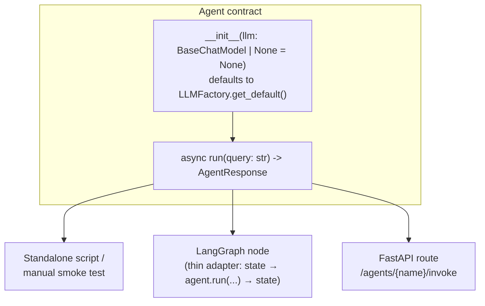

# Technical Design Document

This is the technical design document called for in the capstone submission guidelines ([`../../README.md`](../../README.md) → *Documentation*). It covers system architecture decisions, the agent communication protocol, a design brainstorm + diagram for each of the six agents, RAG implementation details, and performance considerations. For setup/run instructions, see [`../README.md`](../README.md).

---

## Table of Contents

- [1. System Architecture Decisions](#1-system-architecture-decisions)
- [2. Agent Communication Protocol](#2-agent-communication-protocol)
- [3. Agents](#3-agents)
- [4. RAG Implementation Details](#4-rag-implementation-details)
- [5. Performance Considerations](#5-performance-considerations)
- [6. Testing Strategy](#6-testing-strategy)

---

## 1. System Architecture Decisions

| Decision | Choice | Rationale |
|---|---|---|
| Web framework | **FastAPI**, not Streamlit | Spec FAQ explicitly allows substituting the suggested stack if documented ("*you could use FastAPI instead of Streamlit, but explain your reasoning*"). FastAPI gives typed request/response models, native async (needed for MCP's async client), and auto-generated OpenAPI docs — a better fit for a system meant to expose both an orchestrated workflow and independently-callable agents as an API. |
| Orchestration | **LangGraph** `StateGraph` | Matches the spec's own grading weight (LangGraph Workflow is 10% of the grade on its own). A graph gives explicit routing, conditional edges, and a checkpointer for conversation memory — more inspectable than an implicit agent-to-agent handoff. |
| Agent implementation | **LangChain** `create_agent` (ReAct) per agent, wrapped in a plain Python class | Lets each agent be a thin, standalone, testable unit with its own `run()` method — independent of whether LangGraph or FastAPI exists. A LangGraph node is just a one-line adapter calling that same `run()`. |
| Dependency management | **uv** | Single tool for venv + lockfile + dependency groups; fast; `uv sync` is reproducible via `uv.lock`. |
| LLM provider | **Provider-agnostic from day one** (`LLMFactory`, config-driven via `config.yaml`) | The spec recommends Gemini for cost but doesn't mandate it, and grading rewards documented technology choices. Centralizing provider selection in one factory means swapping Gemini ↔ OpenAI ↔ Claude is a one-line config change, never a code change inside an agent. |
| Live portfolio data | **Kite MCP** (`https://mcp.kite.trade/mcp`) instead of only synthetic sample data | The spec's baseline is "portfolio analysis of user input" (synthetic/manual data). Wiring a real brokerage account in via Zerodha's official MCP server is a deliberate reach beyond the base requirement — it's the kind of thing the **Innovation & Future Outlook** bonus rubric rewards, while the read-only tool allowlist (below) keeps it safe. |
| Observability | **LangSmith** tracing via env vars, no code changes | Chosen over Langfuse for now because it's literally three environment variables with LangChain auto-instrumenting every call — the fastest way to see where an agent run is spending time. Langfuse (self-hostable, vendor-neutral) is deferred until the full multi-agent graph exists, where tracing handoffs across agents matters more. |

---

## 2. Agent Communication Protocol

Every agent follows the same shape, so any agent can be used three ways — standalone in a script, as a LangGraph node, or behind a FastAPI route — without its internal code changing.

Two sub-shapes exist depending on whether the agent holds an external connection:

- **Stateless agents** (Finance Q&A, Goal Planning, Tax Education — no persistent external connection) are a plain class: construct it, call `await agent.run(query)`, done.
- **Connection-holding agents** (Portfolio Analysis today; Market Analysis likely, if it also uses Kite MCP for quotes) use the `async with agent as a:` context-manager pattern, so one MCP session is opened in `__aenter__` and reused across every call until `__aexit__` closes it. This was a deliberate fix, not the original design — see [§5 Performance Considerations](#5-performance-considerations) for why re-opening a session per call breaks Kite's login flow.

All agents return the same `AgentResponse` type (`src/core/responses.py`) rather than a raw LangChain message, so the `.content` shape differences between providers (Gemini returns a list of content blocks; OpenAI/Anthropic typically return a plain string) are normalized in one place, not re-handled in every agent and every caller.

---

## 3. Agents

Each agent has its own dedicated design doc — purpose/scope, a detailed architecture diagram, typed I/O, draft system prompt, edge cases, open questions, and a "Definition of Done" checklist tied to the grading rubric. This section is just the index; go to the linked doc for the real brainstorm.

| Agent | Status | Rubric tie | Doc |
|---|---|---|---|
| Finance Q&A | **Implemented** | Educational Content (8%), RAG Implementation (8%) | [`docs/agents/finance_qa_agent.md`](agents/finance_qa_agent.md) |
| Portfolio Analysis | **Implemented** (live Kite and sample) | Portfolio Analysis (7%) | [`docs/agents/portfolio_agent.md`](agents/portfolio_agent.md) |
| Market Analysis | **Implemented** | Real-time Data Integration (7%), Market Intelligence (5%) | [`docs/agents/market_analysis_agent.md`](agents/market_analysis_agent.md) |
| Goal Planning | **Implemented** | Deliverables — goal planning w/ risk appetite | [`docs/agents/goal_planning_agent.md`](agents/goal_planning_agent.md) |
| News Synthesizer | **Implemented** | none named — build last among core+1 | [`docs/agents/news_synthesizer_agent.md`](agents/news_synthesizer_agent.md) |
| Tax Education | **Implemented** | none named — build last | [`docs/agents/tax_education_agent.md`](agents/tax_education_agent.md) |

**Cross-agent notes worth remembering while building the rest:**
- Market Analysis can reuse Kite MCP's quote/OHLC/historical tools (same connection style as Portfolio Analysis) before reaching for a second yfinance/Alpha Vantage integration.
- Finance Q&A and Tax Education share one vector store, differentiated only by a `category` metadata filter — don't build two knowledge bases.
- Goal Planning is the one agent designed to call another agent's `run()` directly (`PortfolioAgent`) for its starting balance — a concrete example of agent-to-agent composition distinct from LangGraph's router-level orchestration.
- Portfolio Analysis's biggest open gap isn't a missing feature so much as a missing *layer*: it currently asks the LLM to narrate raw JSON instead of computing metrics (total value, allocation %, diversification score) in deterministic code first. See its doc for the planned fix — the same "compute in code, narrate with the LLM" pattern should apply to any future agent doing arithmetic.

---

## 4. RAG Implementation Details

*(Implemented: `src/rag/`, configured by `src/config/rag.yaml`. The list below is the original design.)* Content plan (80-topic backlog, trusted sources, article template, metadata schema, guardrails): [`docs/knowledge-base/content-backlog.md`](knowledge-base/content-backlog.md).

- **Vector store**: Chroma (already in `pyproject.toml`) — runs embedded, no separate service to operate for a project this size.
- **Chunking**: recursive character splitting, ~500–800 tokens per chunk with ~10–15% overlap, so a concept explanation isn't severed mid-paragraph.
- **Embeddings**: start with the embedding model from whichever provider `LLMFactory` is already configured for (e.g. Google's embedding model when `provider: google`), to avoid standing up a second provider just for embeddings; revisit a local `sentence-transformers` model only if embedding cost/latency becomes a problem.
- **Metadata**: every chunk tagged with `category` (stocks/bonds/ETFs/tax/...) and `source`, so retrieval can filter by category (used by both the Q&A agent and the Tax agent against the same store) and every answer can cite its source.
- **Retrieval**: top-k similarity search with a relevance-score floor — below-threshold results are dropped rather than forced into the answer, so the agent can say "I don't have a good source for that" instead of fabricating.

---

## 5. Performance Considerations

- **One LLM instance per process.** `LLMFactory.get_default()` caches its instance — every agent that doesn't explicitly inject its own LLM shares one client, avoiding redundant provider SDK initialization.
- **Market data caching (built 2026-11-17, `src/data/market/cache.py`).** `CachedProvider` wraps any `MarketDataProvider`: a 30-minute TTL cache per instrument (history: per instrument and range), exponential backoff (0.5 s, 1 s) on temporary failures only, a stale fallback (an older copy, marked `stale`, when a refresh fails), a 30 s cool-down so an outage is not hammered, and one shared fetch for identical concurrent requests. "Not found" is never cached or retried. All of it is configured in `src/config/app.yaml` under `market_data`. See [`agents/market_analysis_agent.md`](agents/market_analysis_agent.md).
- **MCP connection reuse is not optional — it's required for correctness, not just speed.** Early iterations of the Portfolio Agent called `login()` and the next tool call on what turned out to be two different implicit sessions, which didn't just waste a connection — it silently hung, because Kite's login state is bound to the session that performed it. The fix was holding one `MCPAdapter`/`fastmcp.Client` connection open (via `async with`) across the entire login-and-query lifecycle. Any future connection-holding agent (e.g. Market Analysis, if it also talks to Kite MCP) should follow the same pattern. **Update 2026-11-12:** the hosted server has since moved to OAuth (an unauthenticated client gets `401 no bearer token`) and regrouped its tools (`portfolio`, `session`, `mutual_funds`, … with a `mode` argument, no `login` tool). The held-connection rule still applies, now implemented in `src/data/portfolio/kite.py` (see [`agents/portfolio_agent.md`](agents/portfolio_agent.md)); the old `MCPAdapter` code in `src/agents/portfolio_agent.py` no longer connects.
- **Never block the event loop while a connection is open.** A plain `input()` call (e.g. "press Enter after you've logged in") freezes the whole event loop, including any open MCP connection's ability to service itself. Use `await asyncio.to_thread(input, ...)` for any blocking wait that happens while a connection-holding agent is active.
- **Timeouts around agent calls.** Every `agent.run(...)` call in a connection-holding agent should be wrapped in `asyncio.wait_for(..., timeout=...)` so a server-side hang fails loudly and fast instead of hanging the whole process indefinitely.
- **Tracing over guesswork.** LangSmith is wired up via env vars specifically so questions like "is this slow because of the LLM or the tool call?" are answered by looking at a trace, not by adding print statements.

---

## 6. Testing Strategy

- **Today:** 1,812 automated Python tests (86% line coverage) and 477 web-app tests. No test needs the network or a login: LLMs, providers and the Kite client are replaced by recording fakes. Live checks are separate scripts in `scripts/`. Every change was also mutation-checked (the code deliberately broken to confirm a test notices).
- **Original plan (now done):** an automated suite that mocks `fastmcp.Client` / `MCPAdapter` / `create_agent` so agent logic (tool filtering, response normalization, error handling) is tested without any real network call or login, using `pytest-asyncio` with `asyncio_mode = "auto"` (see `pyproject.toml`). Target: 80%+ coverage per the grading rubric, including edge cases like malformed queries and tool/timeout failures.
- Pure-calculation agents (Goal Planning) are the easiest to hit high coverage on — no mocking required, just assert on the math.
