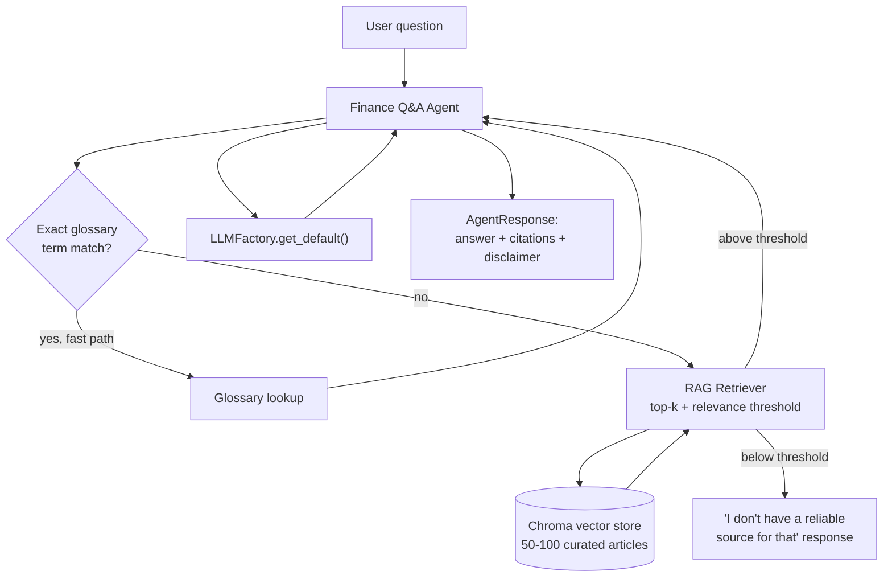

# Finance Q&A Agent

**Status:** Implemented (the design below is the original brainstorm; the code and `tests/agents/financeqaagents/` are the source of truth) · **File:** `src/agents/finance_qa_agent.py` · **Rubric ties:** Educational Content (8%), RAG Implementation (8%)

## Purpose & Scope

General financial education — the "ask anything about investing basics" agent. Answers are grounded in a curated knowledge base rather than the model's unverified prior knowledge, so every answer traces back to a real source. In scope: core concepts (diversification, compound interest, asset classes, fees). Out of scope: specific buy/sell recommendations, account-specific advice (that's what Portfolio/Goal agents are for, and even they stay descriptive, not prescriptive).

## Architecture



The glossary fast-path exists because "what is an ETF?"-style questions don't need a full similarity search — an exact/fuzzy term match against a small glossary table is cheaper and more precise than RAG for single-term lookups. Fall through to RAG for anything else.

## Typed I/O

```python
from pydantic import BaseModel

class QARequest(BaseModel):
    question: str
    category_hint: str | None = None  # "stocks" | "bonds" | "etfs" | "tax" | ... — narrows retrieval

class Citation(BaseModel):
    source: str
    excerpt: str

class QAResult(BaseModel):
    answer: str
    citations: list[Citation]
    disclaimer: str = "Educational information only — not financial advice."
```

## Tools & Data Sources

- Shared Chroma vector store (`src/rag/vector_store.py`, planned) — same store the Tax Education Agent uses, filtered by `category` metadata.
- No external API — fully self-contained once the knowledge base is built.
- Content plan (80-topic backlog, sources, article template, metadata schema): [`../knowledge-base/content-backlog.md`](../knowledge-base/content-backlog.md)

## Prompt (draft)

> You are a financial education assistant. Answer only using the retrieved context provided to you. If the context doesn't cover the question, say so honestly instead of guessing. Never recommend specific securities or give personalized investment advice — explain concepts, don't tell the user what to buy. Always cite which source(s) you used. Keep answers jargon-free; define any technical term you use.

## Features

- Jargon-free explanations of core concepts
- RAG-grounded — every answer cites a source, not model recall
- Category-aware retrieval matching the knowledge base's category structure
- Glossary fast-path for single-term lookups
- Always appends an "educational purposes only" disclaimer
- Standalone: `await FinanceQAAgent().run("What's an expense ratio?")` — no FastAPI/LangGraph required

## Edge Cases & Error Handling

| Case | Behavior |
|---|---|
| No relevant source found (below relevance threshold) | Honest "I don't have a reliable source for that" — never fabricate |
| Off-topic / non-financial question | Polite redirect back to financial education scope |
| Question implying financial distress ("I'm going to lose my house") | Stay in educational framing; suggest a qualified professional / official resource rather than attempting to counsel |
| Ambiguous term (e.g. "bond" — could mean fixed income or a legal bond) | Ask one clarifying question before answering, rather than guessing |

## Open Questions

- Embedding model: reuse whichever provider `LLMFactory` is configured for, or standardize on a local `sentence-transformers` model regardless of LLM provider? (Leaning: reuse provider's embedding model first, revisit only if cost/latency becomes an issue — see `TECHNICAL_DESIGN.md` §4.)
- Relevance threshold value — needs empirical tuning once the knowledge base is populated; start conservative (fewer but more confident answers) and loosen if too many false "no source" responses occur.

## Definition of Done

- [ ] Knowledge base curated (50–100 articles) and chunked into the vector store
- [ ] Glossary fast-path implemented
- [ ] Retrieval relevance threshold tuned (no fabricated answers in manual spot-check)
- [ ] Every response includes at least one citation or an explicit "no source" statement
- [ ] Standalone unit tests with a mocked retriever (no real vector store hit in CI)
