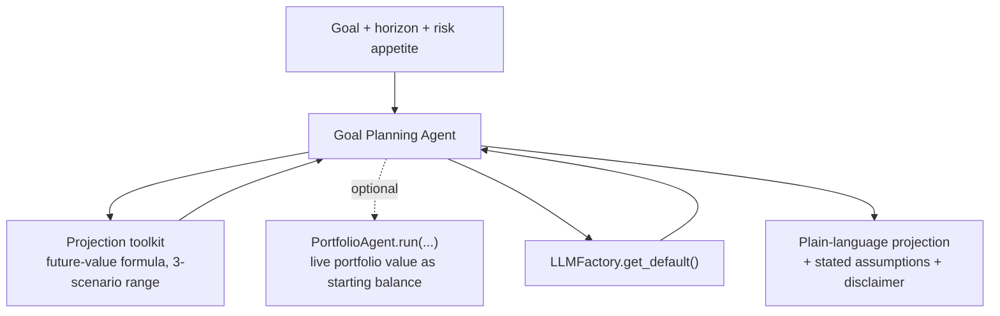

# Goal Planning Agent

**Status:** Implemented (2026-11-14 to 2026-11-16) · see the section at the end for what differs from this draft · was: Planned · **File (planned):** `src/agents/goal_planning_agent.py` · **Rubric ties:** Deliverables — "ability to plan financial goals keeping risk appetite in mind"

## Purpose & Scope

Financial goal projections (e.g. "can I reach $50k in 5 years saving $500/month?"), factoring in risk appetite. Pure calculation — no external API, fully deterministic, fully unit-testable. Out of scope: guaranteeing outcomes — every projection is explicitly framed as an illustrative range, not a promise.

## Architecture



This is the one agent designed to call **another agent directly** (`PortfolioAgent.run(...)`) rather than only being reachable through the LangGraph router — a deliberate example of agent-to-agent composition distinct from graph-level orchestration.

## Projection Method: 3-Scenario, Not Full Monte Carlo

Rather than a full statistical simulation (harder to implement correctly and harder to explain to a beginner user), use the standard future-value-of-a-series formula run at three fixed return-rate assumptions per risk bucket:

```
FV = P·(1+r)^n + PMT·(((1+r)^n − 1) / r)
```
where `P` = starting balance, `r` = monthly rate, `n` = months, `PMT` = monthly contribution.

| Risk appetite | Pessimistic | Expected | Optimistic |
|---|---|---|---|
| Conservative | 2% | 4.5% | 7% |
| Moderate | 3% | 7% | 11% |
| Aggressive | 4% | 10% | 16% |

**These numbers are illustrative historical-average placeholders, not a guarantee** — every response must state this explicitly, and they should be revisited against a cited source (e.g. long-run historical index returns) before shipping, not treated as authoritative financial guidance.

## Typed I/O

```python
from typing import Literal
from pydantic import BaseModel

class GoalRequest(BaseModel):
    goal_name: str
    target_amount: float
    horizon_years: int
    monthly_contribution: float
    risk_appetite: Literal["conservative", "moderate", "aggressive"]
    starting_balance: float | None = None  # if omitted, agent asks or pulls from PortfolioAgent

class GoalProjection(BaseModel):
    scenario: Literal["pessimistic", "expected", "optimistic"]
    projected_value: float
    shortfall_or_surplus: float
```

## Prompt (draft)

> Given the goal, horizon, contribution, and risk appetite, compute projections using the provided calculation tool — never estimate the math yourself. Present all three scenarios (pessimistic/expected/optimistic), state the assumed return rates explicitly, and clearly label this as an illustrative projection, not a guarantee.

## Features

- Risk-appetite-aware projection assumptions (conservative/moderate/aggressive)
- Optional composition with Portfolio Agent's live holdings as the starting balance
- Pure-Python calculation — no external API, no rate limits, deterministic and easy to unit test
- Every response states its assumptions explicitly

## Edge Cases & Error Handling

| Case | Behavior |
|---|---|
| Negative or zero horizon/contribution | Reject with a clear validation message, don't silently compute nonsense |
| Goal already met by starting balance alone | Say so plainly rather than forcing a scenario narrative |
| `PortfolioAgent` call fails (Kite session issue) | Fall back to asking the user for a starting balance directly, don't block the whole goal-planning flow on an unrelated agent's connection health |

## Open Questions

- Should the risk-bucket return assumptions be configurable (e.g. in `config.yaml`) rather than hard-coded, so they can be updated without a code change as market conditions/consensus shifts? Leaning yes.

## Definition of Done

- [ ] Future-value calculation tool implemented and unit-tested (pure math, no mocks needed)
- [ ] 3-scenario output with explicit stated assumptions
- [ ] Optional `PortfolioAgent` composition for starting balance
- [ ] Input validation (horizon, contribution, target > 0)

## Decision (2026-11-02): the risk profile lives here, not in a separate agent

`risk_appetite` is already a required input of this agent ("if omitted, agent asks"). The **risk intake** is that step, made explicit. No seventh agent is added: the spec lists six, and a separate one would only add a routing target.

- **Trigger**: `GoalRequest.risk_appetite` is missing and `UserProfile.risk_appetite` is empty.
- **Flow**: ask 4 to 6 short questions (time horizon, reaction to a 20% fall, income stability, prior experience, need for the money), **score them in deterministic Python** (never LLM arithmetic) into `conservative | moderate | aggressive`, show the result with a one-line explanation, and **ask the user to confirm** before saving.
- **Output**: writes `UserProfile.risk_appetite` with `risk_source="questionnaire"`. An explicit statement ("I'm an aggressive investor") is accepted as `risk_source="stated"`. Never infer it silently, and never default without saying so.
- **Consumers**: this agent (scenario rates), Portfolio (compare with the computed risk bucket), Q&A (explanation level).
- **Education framing**: describe the profile as "how much volatility you said you are comfortable with", not as a verdict on what the user should do.
- **Tests**: the scoring function is pure math, so cover every answer combination and the boundaries between buckets; plus a graph test that the profile is saved only after confirmation.
- **Contract**: `UserProfile` is defined in [`shared_contracts.md`](shared_contracts.md); the router owns persistence (see [`router_agent.md`](router_agent.md)).


## Implementation notes (2026-11-16)

Files: `src/core/goal_math.py` (pure maths), `src/agents/goal_planning_agent.py` (extractor and agent). About 330 tests.

- **Two stages.** An LLM extractor turns words into numbers (lakh, crore, "k", ages, "assuming 12%"). `goal_math` computes. The LLM only narrates, and its story is dropped if it adds a number that is not in the facts.
- **Question shapes:** a projection (monthly and horizon), the monthly amount needed (target and horizon), the time to reach a target, a lump sum, and the user's own return rate. Ages become a horizon (`retire at 50` and `I'm 35` give 15 years).
- **Rates:** the table in this document, or the user's own rate (0 to 30 %, only if written in the current message).
- **Memory v2:** facts carry across turns and are labelled "(from earlier)"; a new value overrides an old one; "start over" clears them; a stated risk appetite is saved to the profile, and a bare "aggressive" after an answer recalculates it.
- **Clarifications** say what is already known ("So far I have: ₹30,000 a month") and ask only for the missing piece.
- **Not built:** the risk questionnaire from the decision above, inflation, step-up SIPs, composing with the Portfolio agent for a starting balance.

## Additions (2026-11-17): chart data and "new goal"

- **`data.paths`** (next to `data.plan`): one entry per scenario, `{name, annual_rate_pct, points: [{year, value}]}`, from `goal_math.balance_path` (a point per whole year from 0, plus the exact horizon if it is not whole). The last point equals the scenario's `projected`, so the Goals chart and the table can never disagree. Absent when the question is "how long will it take" (no horizon).
- **"New goal" with numbers resets and plans in the same turn.** `new goal`, `start over`, `reset` or `forget my numbers` *with* numbers now ignores the numbers remembered from earlier, plans the new goal, and sets `meta.learned.slots_reset` so memory drops the old ones. Without numbers they still only clear. This matters for the Goals tab and the MCP `plan_goal` tool, which send complete statements: before this, a remembered horizon turned a "how long will it take" question into a 10-year projection ("10 years (from earlier)"). Follow-ups without those phrases ("what if I save more?") still carry numbers forward.

## Additions (2026-11-20): starting from the portfolio

A goal question that also says "my portfolio" is answered by two agents: `src/workflow/compose.py` runs the portfolio agent, reads `data.metrics.total_value`, and runs this agent with it as `starting_balance` (through `ctx.slots`, so a number the user stated still wins). The reply is this agent's, with a one-line note written by code ("I'm using your portfolio's current value, ₹X, as the starting balance, and assuming it stays invested toward this goal.") and `meta.collaboration` naming both agents. If the portfolio is not connected, needs a login, is empty or errors, that reply is shown as it is and no projection is made. If the portfolio step crashes, this agent answers alone. Tests: `tests/workflow/portfolio_goal_test.py`. Not yet done: see backlog section 16.
