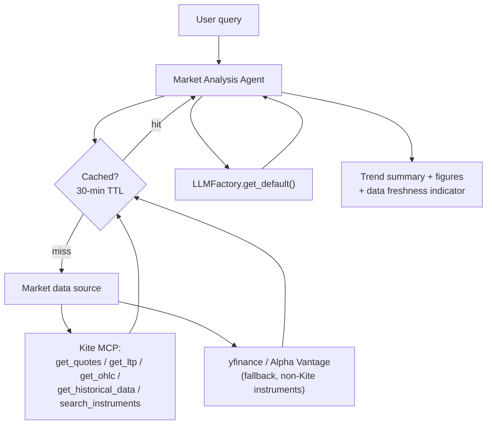

# Market Analysis Agent

**Status:** Implemented (yfinance behind a provider registry; the design below is the original brainstorm; see `tests/agents/marketagents/`) · **File:** `src/agents/market_analysis_agent.py` · **Rubric ties:** Real-time Data Integration (7%), Market Intelligence (5%)

## Purpose & Scope

Real-time quotes, OHLC candles, and trend insight. In scope: current price/change, historical trend summary, instrument search. Out of scope: predictions/forecasts presented as fact — frame everything as "here's what happened," not "here's what will happen."

## Architecture



## Key Design Decision: Reuse Kite MCP Before Adding a Second Integration

Kite MCP already exposes `get_quotes`, `get_ltp`, `get_ohlc`, `get_historical_data`, and `search_instruments` — the same connection style the Portfolio Agent already uses. Standing up yfinance/Alpha Vantage as the *primary* source would duplicate work for anything Kite already covers. Priority order:

1. Kite MCP (covers NSE/BSE instruments, same connection as Portfolio Agent)
2. yfinance (free, broad coverage, no key required) — fallback for non-Indian/other exchanges
3. Alpha Vantage — last resort; free tier is quite restrictive (as low as 25 requests/day on the most limited plan), so treat it as a tertiary fallback, not a primary source

## Typed I/O

```python
from datetime import datetime
from typing import Literal
from pydantic import BaseModel

class QuoteRequest(BaseModel):
    symbols: list[str]

class Quote(BaseModel):
    symbol: str
    price: float
    change_pct: float
    as_of: datetime
    source: Literal["kite", "yfinance", "alpha_vantage"]
```

## Caching (sketch)

```python
from cachetools import TTLCache

_quote_cache: TTLCache = TTLCache(maxsize=256, ttl=1800)  # 30 minutes, per spec FAQ guidance
```

Exponential backoff on rate-limit responses (`429`), falling through to the next source in the priority order rather than failing outright.

## Prompt (draft)

> Summarize market data factually. Never phrase historical moves as predictions. Always state the data's `as_of` timestamp and `source` in your answer. If data is stale (served from cache past its freshness window) or a source failed, say so explicitly rather than presenting it as live.

## Features

- Reuses Kite MCP's market-data tools where possible; yfinance/Alpha Vantage as fallback for instruments Kite doesn't cover
- 30-minute TTL cache + exponential backoff on rate limits
- Explicit data-freshness indicator (timestamp + source) on every response
- Fully standalone — independent of the Portfolio Agent even when sharing Kite as a data source

## Edge Cases & Error Handling

| Case | Behavior |
|---|---|
| Symbol not found on any source | Clear "couldn't find that instrument" rather than a fabricated quote |
| All sources rate-limited simultaneously | Serve last cached value with an explicit staleness warning, don't fail outright |
| Ambiguous ticker across exchanges | Use `search_instruments` to disambiguate, or ask the user which exchange |

## Open Questions

- Does the Market Analysis Agent hold its own persistent Kite MCP connection, or share one with the Portfolio Agent? Sharing avoids a second login flow but couples the two agents' lifecycles — leaning toward separate connections for independence, revisit if login friction becomes annoying in practice.

## Definition of Done

- [ ] Kite MCP quote/OHLC/historical tools wired as primary source
- [ ] yfinance fallback implemented
- [ ] TTL cache + backoff implemented
- [ ] Every response includes `as_of` + `source`
- [ ] Standalone tests with mocked data sources (no real API calls in CI)

## Decisions (2026-11-02): yfinance is a first-class source, order is configuration

- **Source order is configuration, not a hard-coded priority.** The spec names **Alpha Vantage / yFinance** as the live-quote deliverable, and yfinance needs no key and no login, so it is the demo-safe default. Kite stays supported for users who are logged in (and for NSE/BSE instruments Kite searches well). Default: `market_data.providers: [yfinance, kite]`. This supersedes the "Kite first" ordering above; the reasoning there (avoid duplicate integrations) still holds through the shared `MarketDataProvider` interface.
- **One shared interface** (`MarketDataProvider` in [`shared_contracts.md`](shared_contracts.md)) with `CachedProvider` (30-minute TTL) and `FallbackProvider` wrappers. The Portfolio agent uses the same providers for valuation, so caching and rate limits are handled once.
- **Symbols**: callers use a canonical `Instrument`; each provider maps it (yfinance suffixes such as `.NS` / `.BO` and its own index symbols; Kite `NSE:SYMBOL`). Verify mappings against live responses, especially indexes (Nifty, Sensex).
- **yfinance caveats**: unofficial, can rate-limit or change without notice, and is blocking I/O (call via `asyncio.to_thread`). Hence the cache, the fallback chain and a `stale` flag on `Quote`.
- **Routing**: the router sends price, quote and "how did X do" questions here (for example, "What was the Nifty 50 close yesterday?"); the Q&A agent no longer has to refuse them.

## Addition (2026-11-17): price history

`MarketDataProvider.history(instrument, range)` returns a `PriceHistory` (daily closes, oldest first) or `None`; `range` is `1m`, `3m`, `6m` or `1y`. The yfinance provider asks for adjusted daily bars in a worker thread, drops NaN and non-positive closes, rounds to two decimals, and returns `None` for any failure or an empty table. `src/data/market/history.py` computes the summary (latest, high, low, change over the range) and `symbols.resolve_instrument` turns what a user typed into an `Instrument`. It feeds `GET /market/history` (see `docs/API.md`); the agent exposes its `provider` so the API can reach it. It is cached (see the next section).

## Addition (2026-11-17): cache, retry and stale fallback

`build_agents` wraps the yfinance provider in `CachedProvider` (`src/data/market/cache.py`), so the Market agent, the Portfolio pricing step and `GET /market/history` all share one cache. Settings are in `src/config/app.yaml` under `market_data`.

| Behaviour | Rule |
|---|---|
| Cache | per instrument for quotes, per instrument and range for history; `cache_ttl_seconds` (default 1800); least recently used out first beyond `cache_max_entries` (512). `0` switches the cache off |
| What is a failure | `ProviderUnavailable`: a rate limit (`YFRateLimitError`) or a network error or timeout (an `OSError`). An unknown symbol is not a failure: it comes back as no quote / `None`, is **never cached and never retried** |
| Retry | `retries` (2) more attempts, waiting `retry_base_seconds` (0.5), then double: 0.5 s, 1 s. Other exceptions are bugs and pass straight through |
| Stale fallback | when every attempt fails and an older copy younger than `cache_max_stale_seconds` (a day) exists, it is returned with `stale: true` and its **original** `as_of`. The agent adds "could not refresh, may be out of date" to that price; the Market tab shows a warning. With nothing cached the outage is raised: an error reply with `retryable` for chat, HTTP 502 for history |
| Cool-down | after a failed refresh, that key is left alone for `cooldown_seconds` (30): no attempts, no waiting |
| Concurrency | identical requests in flight at once share one fetch, and one caller giving up does not cancel it for the others |
| Honesty | a cache hit keeps the time the data was really fetched, so "fetched 14:05 IST" and "updated 12 min ago" are true, not the time of the request |

Measured live: a cold quote 500 ms and a cached one 0.1 ms; a cold history 335 ms through the API and 1.3 ms cached; six identical concurrent history calls made one fetch.
