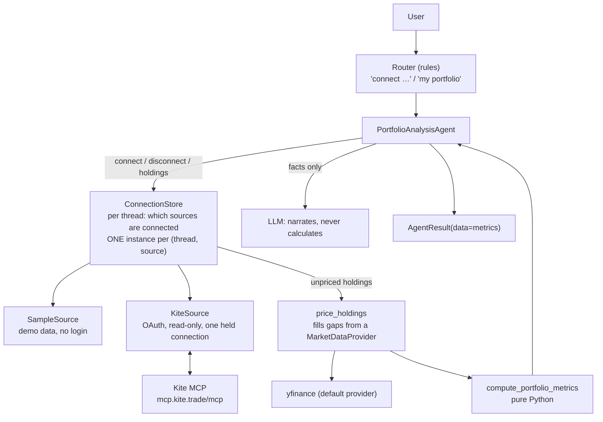

# Portfolio Analysis Agent

**Status:** Implemented and verified live against a real Zerodha account (2026-11-12) · **Files:** `src/agents/portfolio_analysis_agent.py`, `src/data/portfolio/` · **Rubric ties:** Portfolio Analysis (7%), Multi-Agent Architecture (10%)

## Purpose & scope

Describes the user's portfolio in plain language from whatever source they have connected, with every number computed in code. A live Zerodha account is one source among several, so a reviewer with no brokerage account can still run the full flow on the bundled sample portfolio.

In scope: connect and disconnect sources, holdings, prices, allocation, diversification, a risk bucket, a plain-language narration. Out of scope, and enforced in code: placing, modifying or cancelling orders, GTTs and alerts. This is an analysis agent, not a trading agent.

## How a conversation works

```
you:     connect to my portfolio
Finnie:  I can analyze a portfolio from these sources:                       [status: clarify]
         - Sample portfolio (demo data, no login): say `connect sample`
         - Zerodha Kite (live account, read-only, needs login): say `connect kite`

you:     connect kite
Finnie:  Open the link, log in to Zerodha and approve access, then say        [status: needs_login]
         'connect kite' again.            >>> https://mcp.kite.trade/authorize?...

you:     (opens the link, logs in with password + TOTP, approves)
you:     connect kite
Finnie:  Connected to Zerodha Kite (read-only). Say 'analyze my portfolio'.   [status: ok]

you:     analyze my portfolio     → real holdings, priced, with metrics        [status: ok]
you:     analyze my portfolio     → again, with NO login prompt
you:     disconnect kite          → Disconnected kite.
```

The commands are explicit on purpose (`connect <source>` is matched by a router rule and by `parse_command`).

### A question asked before connecting is answered after

```
you:     how's the market treating me?     → the menu (the question is remembered for this thread)
you:     connect kite                      → login link (still remembered)
you:     connect kite                      → "Connected to Zerodha Kite (read-only)." + the analysis of YOUR question
```

The question lives in `ConnectionStore` (`set_pending` / `take_pending` / `clear_pending`). It is stored when the agent has to send the user away (nothing connected, or an expired session), answered once by the next successful connect, replaced by a newer question, and forgotten by `disconnect` and `close_all`. A bare "connect to my portfolio" is not a question and stores nothing. If the analysis fails after connecting, the user still hears "Connected" and is told to retry. `_analyze(resuming=True)` stops a source that reports connected but keeps expiring from looping. It is in memory only, so an app restart forgets it, as it forgets the login.

## Architecture



| Piece | File | Job |
|---|---|---|
| Agent | `src/agents/portfolio_analysis_agent.py` | parse the command, run connect / disconnect / analyze, build the facts block, ask the LLM to narrate |
| Source interface and registry | `src/data/portfolio/base.py` | `PortfolioSource` (`status`, `connect`, `holdings`), `ConnectInfo`, `SessionExpired`, `@register_source` |
| Connection store | `src/data/portfolio/store.py` | which sources each thread has connected; one live instance per (thread, source); `opened`, `disconnect`, `close_all` |
| Sample source | `src/data/portfolio/sample.py` | seven demo holdings, no login |
| Kite source | `src/data/portfolio/kite.py` | OAuth login, held connection, three read-only calls, paging, expiry handling |
| Pricing | `src/data/portfolio/pricing.py` | `price_holdings`: fills missing prices, keeps live broker prices, reports when and from where |
| Metrics | `src/data/portfolio/metrics.py` | `compute_portfolio_metrics`: totals, allocation, diversification, risk bucket |

Adding a provider tomorrow is one class plus `@register_source("name")`; the menu, the connect flow and the metrics need no change.

## The Kite source (verified against the live server)

**Login is OAuth.** The endpoint answers `401 no bearer token` to an unauthenticated client. The source connects with `fastmcp`'s `OAuth` helper, but replaces the browser-opening step with a callback that hands the authorization link to the agent. The link goes back to the user as `needs_login` with `data["login_url"]`, and each interface decides how to show it.

**The login runs in a background task.** Entering an OAuth client blocks until the user approves, but `connect` must return the link at once. So the attempt runs as a task: `connect` returns the link while the task waits, and the next `connect kite` finds the finished connection.

**One login per session, until `disconnect`.** The source keeps its connection open. Repeating `connect kite` only re-checks it (`session status`), and `analyze my portfolio` reuses it. If the check fails, the dead connection is closed and a fresh login link is issued.

**Only three calls are possible.** Kite's server groups many actions behind each tool, so the allowlist is by `(tool, mode)`:

| Allowed | Used for |
|---|---|
| `session` / `status` | "am I logged in?" (`authenticated`, `kite_session_expired`, `terminated`) |
| `portfolio` / `holdings` | equity holdings, `type=full`, paged (`limit=500`, `from=…`, stop on `pagination.has_more`) |
| `mutual_funds` / `holdings` | mutual fund holdings |

Everything else is refused before the client is touched: `orders` (place / modify / cancel), `gtt`, `alerts`, `session/logout` (it would end the Zerodha session for every client), `portfolio/profile`, `positions`, `margins`. The server also asks for browser approval before an order, but that is Kite's protection; ours is that the code cannot ask.

**Field mapping.** `quantity + t1_quantity` is what you own (settled plus arriving tomorrow). A `last_price` of 0 becomes "no price" so `price_holdings` fills it from yfinance, and a portfolio is never valued at zero. Rows with zero quantity are dropped.

**Not verified:** the field names of a mutual fund row. The test account holds no funds (`data: []`), so `tradingsymbol`, `fund`, `quantity`, `average_price`, `last_price` are assumed from Kite Connect. Check this first if fund numbers ever look wrong.

## Metrics (all in code, never by the LLM)

| Number | Rule |
|---|---|
| value | `quantity × price`; allocation = value / total × 100 |
| diversification | `1 − Σ(weight²)` (one holding = 0, two equal = 0.5, four equal = 0.75) |
| risk bucket | share held in equity-like assets: ≥ 70 % aggressive, ≥ 40 % moderate, otherwise conservative; one holding ≥ 50 % bumps it up one level (capped at aggressive) |
| fund costs | `Σ(value × expense ratio / 100)` over the funds whose ratio is known; weighted ratio = that cost / their value; coverage = their share of the portfolio; funds with no known ratio are named, never guessed. The demo portfolio's ratios are illustrative, and a broker that reports none (Kite) shows "not known" |
| unpriced | holdings with no price are left out of the totals and named in the answer, never guessed |
| unclassified | holdings without an asset class are treated as higher risk and named |

If the user has stated a risk appetite, the answer adds one descriptive sentence ("Your stated risk appetite is conservative; this portfolio looks aggressive."). It never says what to do.

## Safety and wording

- The system prompt is analysis-only: describe, never advise, never predict, no buy / sell / rebalance wording. A test asserts the old "trading assistant" wording is gone.
- When the guard flags `advice_seeking`, an extra instruction tells the model to explain what the numbers show and which factors a person would weigh.
- Sample data is always labelled `(demo data)` in the answer.
- A failure of the narration step still returns the numbers. A failure of the data steps returns a friendly error with `meta.retryable`, and the cause goes to the log, never to the user.

## Edge cases

| Case | Behaviour |
|---|---|
| Nothing connected | `clarify` with the menu ("You haven't connected a portfolio yet.") |
| Unknown source (`connect robinhood portfolio`) | the menu, with the unknown name mentioned |
| Source connected but empty | `ok`, "Your connected portfolio has no holdings yet." |
| A holding with no price | named in the answer, excluded from totals |
| Nothing could be priced | `error`, retryable, "I couldn't price any of your holdings right now." |
| Kite session expires mid-conversation | `analyze` restarts the login and answers `needs_login` with a fresh link |
| Login never approved | the pending attempt times out; the next `connect kite` starts a new one |
| Kite or the network does not respond | fails after the timeout (30 s per call) with a message, never hangs |
| `disconnect` while a login is still pending | the half-open connection is closed too |
| Server never stops paging | error after 20 pages instead of an endless loop |

## Lessons learned

- **Session binding.** A Kite login belongs to the connection that made it. Hold one connection per user session and reuse it; a second connection silently loses the login.
- **Never block the event loop while the connection is open.** Use `await asyncio.to_thread(input, …)` for any prompt. The same applies here: the OAuth callback is served by a small `localhost` server on the same loop.
- **Every call has a timeout**, so a server-side hang fails loudly.
- **The server's tools changed twice.** The old flat tools (`get_holdings`, `login`, …) were replaced by grouped ones (`portfolio`, `session`, …), and unauthenticated access was replaced by OAuth. The README lags behind the hosted server. Read the live tool list (`scripts/kite_tools.py`) and reply shapes (`scripts/kite_shape.py`, types only, no values) instead of trusting documentation.
- **A tool-name allowlist is not enough** once one tool bundles reads and writes. Allow `(tool, mode)` pairs.
- **A half-finished login still holds a connection.** `disconnect` must find it (`ConnectionStore.opened`) and close it.

## Known limits

- The login link only works on the machine running the app, because approval returns to a `localhost` callback. That suits a local CLI or demo, not a deployed server.
- Tokens are held in memory only, so each new run needs a fresh login. Kite sessions expire daily anyway; persisting tokens is a possible later addition and needs a decision about storing brokerage credentials on disk.
- `connect <unknown word>` with no portfolio-like word reaches the Q&A agent, not this one, because the router rule requires a known word to avoid catching phrases like "connect the dots".

## Definition of Done

- [x] Live holdings and mutual funds through Kite MCP (verified with a real account, 2026-11-12)
- [x] Read-only by `(tool, mode)`; 20 tests try the forbidden calls
- [x] Standalone and through the graph (`connect`, `disconnect`, `analyze`)
- [x] `compute_portfolio_metrics`: total, allocation, diversification, risk bucket, in pure Python (31 tests)
- [x] Prices from a `MarketDataProvider` (yfinance) when the source has none (19 tests)
- [x] `needs_login` with a link instead of a hang; one login per session; fresh link on expiry
- [x] Empty portfolio, unpriced holdings, expired session and timeouts handled
- [x] Automated tests with a fake MCP client, no network and no login (70 Kite tests, 50+ agent tests)
- [ ] `csv` and `manual` sources
- [x] A portfolio question asked before connecting is answered after the connection (2026-11-14, 19 tests)
