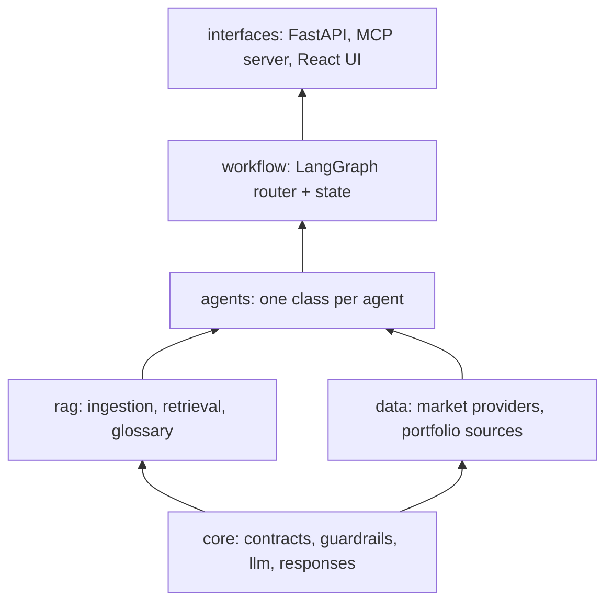
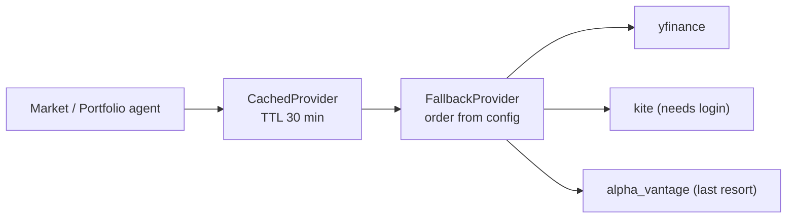

# Shared Contracts

**Status:** Planned · **Files (planned):** `src/core/contracts.py`, `src/data/market/`, `src/data/portfolio/` · **Rubric ties:** Multi-Agent Architecture (10%), Code Organization (5%), Testing (5%)

## Purpose & Scope

The small set of types and interfaces that **every agent, the router, FastAPI, the MCP server and the UI agree on**. No agent logic lives here. The goal is that the router can call any agent the same way, the UI can render any result the same way, and a new agent or data source is added by implementing an interface, not by editing the callers.

**Why this doc exists.** Today the pieces disagree: the Finance Q&A agent returns a `QAResult`, the Portfolio agent returns an `AgentResponse` (text only), and the design doc says `run() -> AgentResponse`. There are three entry points (a LangGraph node, a FastAPI route, an MCP tool) and the UI needs chart-ready numbers, not narrated text. One envelope and one protocol fix all of that.

## Layering (dependency direction)



Rule: **arrows only point upward; nothing imports from a layer above it.** Today one import breaks this: `src/rag/common/models.py` imports `QASettings` from the agent layer to type the `Rag` dataclass (backlog X9). Move `Rag` into `bootstrap.py`.

## 1. `AgentResult`: the one return type

```python
Status = Literal["ok", "no_source", "clarify", "redirect", "needs_login", "error"]

class AgentResult(BaseModel):
    agent: str                              # "finance_qa", "portfolio", "market", ...
    status: Status
    text: str                               # what the user reads
    data: dict[str, Any] | None = None      # chart-ready / machine-readable; never parsed back out of `text`
    citations: list[Citation] = []
    disclaimer: str
    meta: dict[str, Any] = {}               # route, best_score, flags, latency_ms, sources_used
```

Mapping from today's `QAResult`:

| `QAResult.route` | `AgentResult.status` | `meta.route` |
|---|---|---|
| `rag`, `glossary` | `ok` | `rag` / `glossary` |
| `no_source` | `no_source` | |
| `clarify` | `clarify` | |
| `redirect` | `redirect` | |
| (new) LLM / provider failure | `error` | |
| (new) Kite not logged in | `needs_login` (with `data.login_url`) | |

**Invariants every agent must hold** (checked by one shared contract test, section 9):
- `disclaimer` is never empty; `text` is never empty.
- `run()` never raises: failures become `status="error"` with a friendly message (no raw provider text).
- `needs_login` always carries `data.login_url`.
- Numbers shown in `text` also appear in `data` when the agent computed them.

`Citation` has **one canonical definition** (the dataclass now in `src/rag/common/models.py`). Move it to `src/core/contracts.py` and have `rag` re-export it; delete the duplicate Pydantic `Citation` in `src/common/interfaces.py` (backlog A2).

## 2. `Agent` protocol and `AgentContext`

```python
class AgentContext(BaseModel):
    thread_id: str
    profile: UserProfile
    history: list[Turn] = []                # last N turns, already trimmed by the router
    category_hint: str | None = None
    flags: frozenset[str] = frozenset()     # from the input guard: advice_seeking, financial_distress, ...

class Agent(Protocol):
    name: str
    async def run(self, query: str, ctx: AgentContext | None = None) -> AgentResult: ...
```

- `ctx` is **optional**, so the standalone usage each agent doc promises still works: `await FinanceQAAgent().run("What is a SIP?")`. With no context, the agent runs the input guard itself.
- With a context, the agent **reads `ctx.flags`** and does not re-run the guard. One place classifies the message (the graph), everyone consumes the result.
- Connection-holding agents (Portfolio, Market if it uses Kite) additionally support `async with agent:` as documented in `TECHNICAL_DESIGN.md`.

### Composition: leaf agents, composite agents, and entry points (2026-11-03)

| Kind | Examples | May call |
|---|---|---|
| **Leaf agent** | Finance Q&A, Tax, Portfolio, Market | no other agent |
| **Composite agent** | Goal Planning, a future Portfolio Review | leaf agents, **directly** via `run(query, ctx)` |
| **Entry point** | CLI, FastAPI, MCP, React UI | the **router** (`graph.ainvoke`), see [`router_agent.md`](router_agent.md) |

Rules for a composite agent calling a leaf agent:

1. Call only `run(query, ctx)` and read only `AgentResult.data`. Never parse `text`, never import the callee's internals.
2. **Pass `ctx` through**, so profile, thread and guard flags travel with the call.
3. **Handle every `status`** (`needs_login`, `error`, `no_source`, ...). The Goal agent's fallback is the model: if Portfolio fails, ask the user for a starting balance.
4. Calls are one-directional and shallow (leaf agents never call back), so there are no cycles and no hidden LLM cost.

Why: a direct `run()` call has the same shape whether the callee is in this process or, later, behind a remote endpoint. This keeps an **A2A (Agent2Agent) wrapper** possible without rewriting agents: `Agent.name` maps to an Agent Card, `AgentContext.thread_id` to `contextId`, `AgentResult.status` to task states (`clarify` to input-required, `needs_login` to auth-required, `error` to failed), `text` and `data` to message parts. Building A2A is **not** planned; the contract just must not rule it out. Avoid: hidden shared state between agents, agents returning plain strings, and calls that reach into another agent's internals.

## 3. `UserProfile`

```python
class UserProfile(BaseModel):
    risk_appetite: Literal["conservative", "moderate", "aggressive"] | None = None
    risk_source: Literal["questionnaire", "stated", "default"] | None = None
    knowledge_level: Literal["beginner", "intermediate", "advanced"] = "beginner"
    jurisdiction: str = "india"
    currency: str = "INR"
    goals: list[str] = []
```

- **Owner:** the LangGraph state, checkpointed per `thread_id`.
- **Written by:** the Goal Planning agent's risk intake (see `goal_planning_agent.md`) or an explicit user statement ("I'm an aggressive investor"). The assistant **echoes the change back** for confirmation. It never infers risk appetite silently.
- **Read by:** Goal Planning (required input), Portfolio (compare the portfolio's risk bucket to the stated appetite), Q&A (explanation level), Tax (jurisdiction).
- **Privacy:** never logged; stored per thread; deletable.

## 4. Shared guard layer

The guardrails already built for Q&A move to the **graph level** so every agent benefits (today only Q&A has them, and `portfolio_agent.py` still says *"You are a helpful trading assistant"*).

| Function / node | Behaviour |
|---|---|
| `input_guard(text) -> GuardVerdict` | the existing `Guardrails.check` (empty, too long, self-harm block; distress / advice / injection flags) |
| `output_guard(result, verdict, ctx) -> AgentResult` | appends the distress suffix (`finalize`), ensures a disclaimer exists, scans for recommendation language ("you should buy…") and rewrites or caveats it |

Per-agent policy (the disclaimer and the one hard rule):

| Agent | Disclaimer | Hard rule |
|---|---|---|
| finance_qa | educational only, not financial advice | no recommendations |
| tax | stronger: not tax advice, consult a professional | no current rates, brackets or deadlines stated as fact |
| portfolio | analysis, not advice | read-only; no buy/sell suggestions |
| market | data may be delayed; not a prediction | historical framing only; always `as_of` + `source` |
| goal | illustrative projections, not guarantees | assumptions always stated |
| news | summary, not a trading signal | never phrase news as a signal |

## 5. `MarketDataProvider`: yfinance, Kite and Alpha Vantage behind one interface

Used by **Market** (primary), **Portfolio** (valuation when the holdings source has no live prices) and optionally **Goal** (benchmark returns).

```python
class Instrument(BaseModel):
    symbol: str                             # canonical, e.g. "RELIANCE"
    exchange: Literal["NSE", "BSE", "US", "INDEX"] = "NSE"

class Quote(BaseModel):
    instrument: Instrument
    price: float
    change_pct: float | None
    currency: str
    as_of: datetime
    source: Literal["yfinance", "kite", "alpha_vantage", "cache"]
    stale: bool = False

class Candle(BaseModel):
    ts: datetime; open: float; high: float; low: float; close: float; volume: float | None

class MarketDataProvider(Protocol):
    name: str
    async def quotes(self, instruments: list[Instrument]) -> list[Quote]: ...
    async def history(self, instrument: Instrument, period: str = "1y", interval: str = "1d") -> list[Candle]: ...
    async def search(self, query: str) -> list[Instrument]: ...
```

Composition (same registry/factory pattern as the RAG plugins):



- **Order is configuration**, not code: `market_data.providers: [yfinance, kite]`. The spec names yFinance / Alpha Vantage explicitly and yfinance needs no key and no login, so it is the demo-safe default. Kite stays available where the user is logged in.
- **Symbol mapping lives in each provider.** yfinance uses suffixes (`RELIANCE.NS`, `RELIANCE.BO`) and its own index symbols; Kite uses `NSE:RELIANCE`. Callers only ever pass `Instrument`. *Verify each mapping against live responses; index symbols in particular.*
- **yfinance is unofficial** (it reads Yahoo), so expect occasional breakage and rate limits: hence the cache, the fallback chain, and the `stale` flag. It is blocking I/O, so providers call it via `asyncio.to_thread` (the same approach as retrieval in the Q&A agent).
- Every `Quote` carries `as_of` and `source`; the agents must surface both (see the market doc).

## 6. `PortfolioSource`: Kite, CSV, sample and manual input behind one interface

The spec's baseline is *"portfolio analysis of user input"*; Kite is a deliberate extra. So holdings come from a source interface, and Kite is one implementation.

```python
class Holding(BaseModel):
    instrument: Instrument                  # exchange: NSE | BSE | US | INDEX | MF
    quantity: float                         # >= 0
    avg_price: float | None = None
    asset_class: str | None = None          # equity | equity_fund | debt_fund | gold | cash ...
    current_price: float | None = None      # filled from a MarketDataProvider when missing (None or 0 = unknown)

class ConnectInfo(BaseModel):
    connected: bool
    message: str                            # what to tell the user next
    login_url: str | None = None            # set when the user must log in somewhere

class PortfolioSource(Protocol):
    name: str                               # registry key, e.g. "kite"
    label: str                              # class attribute: shown in the menu without creating an instance
    async def status(self) -> Literal["connected", "needs_login", "available"]: ...
    async def connect(self, **params) -> ConnectInfo: ...    # idempotent: the same call finishes a pending login
    async def holdings(self) -> list[Holding]: ...           # may raise SessionExpired

class SessionExpired(Exception):            # a live source lost its session; .source names which one
```

Sources register themselves with `@register_source("name")` when their module is imported. A `ConnectionStore`
keeps, per thread, which sources are connected and holds **one live instance per (thread, source)** (a Kite login
is bound to the connection that made it). `store.opened()` includes logins still pending; `store.disconnect()`
returns the instance so the caller can `await instance.close()`; `store.close_all()` runs at app shutdown.

| Source | Use | Notes |
|---|---|---|
| `kite` | live account | OAuth login (the link comes back as `needs_login`), one held connection, three read-only calls (`session/status`, `portfolio/holdings`, `mutual_funds/holdings`); see [`portfolio_agent.md`](portfolio_agent.md) |
| `sample` | demo and tests | seven bundled holdings, no login, always labelled "demo data" |
| `csv` | user upload or paste | columns `symbol, quantity, avg_price` (not built yet) |
| `manual` | typed in chat ("I hold 10 TCS and 5 INFY") | parsed deterministically; ask when unsure (not built yet) |

Flow: `source.holdings()` → fill missing prices from `MarketDataProvider` → **`compute_portfolio_metrics` (pure Python)** → the LLM narrates → `AgentResult(data=metrics)`. The LLM never does the arithmetic.

## 7. Errors, timeouts, retries

| Error | Becomes | Notes |
|---|---|---|
| bad or unsafe input | `redirect` / `clarify` | guard or agent decides |
| provider or LLM unavailable | `error`, `meta.retryable=True` | friendly text only; log the cause, not the user's data |
| Kite session missing or expired | `needs_login` | router stores a pending action (see `router_agent.md`) |

Per-call timeouts come from config (starting points: LLM 30 s, market 10 s, Kite 60 s, from the portfolio doc's lessons). `asyncio.wait_for` around every external call. Retries only on 429 / 5xx with backoff.

## 8. Logging & privacy

Log categories, ids, route decisions and latencies. **Never log** question text, holdings, profile values or API responses containing them. Use `thread_id` as the correlation id. This is the same rule the guardrails already follow.

## 9. Contract tests

- `tests/contracts/agent_contract_test.py`: parametrized over every agent built with fakes; asserts the `AgentResult` invariants (disclaimer present, valid status, never raises, `needs_login` has a URL).
- Provider contract tests: each `MarketDataProvider` and `PortfolioSource` is run against recorded or fake responses and must return valid `Quote` / `Holding` models.
- Fakes live in `tests/conftest.py` (already: `FakeLLM`, `FakeRetriever`, `FakeGlossary`; add `FakeMarketData`, `FakePortfolioSource`).

## Migration from today's code

1. Create `src/core/contracts.py` (`AgentResult`, `AgentContext`, `UserProfile`, `Citation`). Re-export `Citation` from `rag.common.models`.
2. Add `QAResult.to_result() -> AgentResult` first (so the 27 passing agent tests keep working), and switch `run()` over later.
3. Wrap `PortfolioAgent` output in `AgentResult`; fix its system prompt.
4. Move `Rag` into `bootstrap.py` (X9); delete the duplicate Pydantic `Citation`.
5. `pyproject.toml`: declare `fastmcp` and `cachetools` (installed but undeclared), add `langgraph-checkpoint-sqlite` when the memory moves off in-memory (the React UI is a separate npm project, so it needs no Python dependency).

## Open Questions

- One `app.yaml` for `workflow:`, `market_data:`, `portfolio:`, or extend `rag.yaml`? Leaning one `app.yaml` plus the existing `rag.yaml` and `config.yaml` (LLM).
- Should `AgentContext.history` carry raw turns or a rolling summary? Start with the last 6 raw turns.
- Do Tax and Q&A share one `QAPipeline` parameterized by a profile (category, prompt, numbers policy, disclaimer)? Leaning yes: two graph nodes, one implementation.

## Definition of Done

- [x] `src/core/contracts.py` with `AgentResult`, `AgentContext`, `UserProfile`, `Citation` (done 2026-11-03, 21 tests)
- [ ] Q&A and Portfolio return `AgentResult` (adapter acceptable at first). **Q&A done 2026-11-03**: `run(query, ctx)` returns `AgentResult` via `QAResult.to_result()`; `ask()` keeps the rich `QAResult`. Portfolio still open
- [ ] `MarketDataProvider` with yfinance and Kite implementations, cache and fallback
- [ ] `PortfolioSource` with Kite, CSV and sample implementations
- [ ] Guards callable as graph nodes; output guard implemented
- [ ] Shared agent contract test passing for every agent
- [ ] `Rag` moved out of the RAG layer; one `Citation`


## 9. Memory contract (added 2026-11-16)

Agents hand facts back to the session through `AgentResult.meta`, and the router passes them back in through `AgentContext`.

| Direction | Field | Meaning |
|---|---|---|
| agent → memory | `meta["learned"]["profile"]` | fields of `UserProfile` the user stated (for example `risk_appetite`, `risk_source`). Saved for the thread and given to **every** agent as `ctx.profile` |
| agent → memory | `meta["learned"]["slots"]` | this agent's working facts. Saved per `(thread, agent)` and returned as `ctx.slots` to **that agent only** |
| agent → memory | `meta["learned"]["slots_reset"]` | forget this agent's slots first, then apply any new ones. The profile is untouched |
| agent → memory | `meta["summary"]` | one line stored in the history instead of the full answer |
| agent → router | `meta["awaiting"]` on a `clarify` | "my question is waiting": a short answer is routed back to this agent |

Rules: `None` values never erase a saved fact; malformed `learned` data is ignored, never raised; failures (`error`, `redirect`, `needs_login`) learn nothing; the router's own replies never cancel an agent's pending question and never count as "the last agent".

**Grounding.** Anything an LLM narrates must stay inside the facts it was given: every number in the story must appear in the facts or in the user's question (`src/core/grounding.py`). A story that fails is dropped. Used by the goal, portfolio and news agents.

**Values read out of history are suggestions, not statements.** A return rate or a risk level is accepted only if it is written in the user's current message. Saved facts still carry over through memory, labelled "(from earlier)". (Two live bugs came from the model reading a rate and a risk level out of its own earlier answers.)
